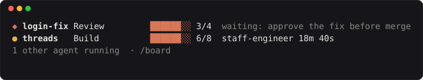
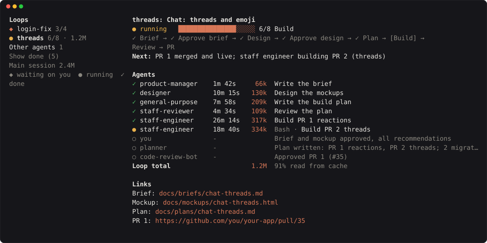

# Agent board

A live board of your work in Claude Code. Each piece of work shows its stage,
what happens next, and the agents working on it. The board sits above the
prompt, and `/board` opens the full view.

Above the prompt, one line per piece of work. What needs you comes first:



`/board` opens the full view. Pick a piece of work on the left to see its
stages, what happens next, every agent that has worked on it (how long it took,
how many tokens it used and what it is doing now), notes, links and the work's
token total:



- **◆ waiting on you.** Claude needs a decision or an approval.
- **● running.** Claude or its agents are working.
- **◇ waiting on others.** An app review, a vendor or a teammate. These sit
  below your own work, so they don't bury what needs you.
- **✓ done.** The work is finished. `/board` can show or hide finished work.
- **⚠ check.** Something about the file looks out of date (see below).
- **○ a note.** A line from the loop file's `notes`, for people or steps that
  aren't agents, like your approval or a code review bot.

## Install

In a Claude Code terminal session:

```
/plugin install agent-board --marketplace rajgurung/agent-board
```

Answer `y` to add the marketplace, then pick a scope. The user scope makes the
board show up in every project.

## How it works

You don't set anything up. The plugin adds a short section to Claude's
instructions explaining two habits, and the board reads what they produce.

1. **One file per piece of work.** Claude keeps `.claude/loops/<id>.json` up to
   date as the work moves along:

   ```json
   {
     "decision": "threads",
     "title": "Chat: threads and emoji",
     "stages": ["Brief", "Design", "Plan", "Build", "Review", "PR"],
     "stage": 4,
     "next": "Staff reviewer checking the plan",
     "state": "running",
     "notes": { "designer": "Mockup approved" },
     "links": { "Plan": "docs/plans/chat-threads.md", "PR": "https://github.com/you/app/pull/12" }
   }
   ```

   The stages are whatever fits the work. `state` is `waiting`, `running` or
   `done`.

2. **Agent names start with the work's id.** A subagent described as
   `threads: Review the plan` shows under "threads". Agents without a prefix
   show under "Other agents" in `/board`.

The board checks the files every two seconds, and it watches agents start and
finish as they happen.

You can also write or edit a loop file yourself. The board shows whatever is in
the folder.

### Keeping it honest

A board is only useful while its files are true. The board flags an open piece
of work with ⚠ when:

- **Its PRs have all merged.** Put each pull request's github.com URL in
  `links`. Every five minutes the board asks `gh` whether they're merged, and
  shows "PRs merged: close it?" if the file still says it's open. Without `gh`
  the check stays quiet.
- **Nothing has changed for 3 days.** "no update for 4d".
- **Its stage is past the end.** "stage 8 of 5".

Work waiting on someone else gets `"waiting_on": "Apple"` (or Google, a
reviewer, a teammate). Leave it out when it waits on you.

Finished files can move into `.claude/loops/archive/`. The board only reads
files directly in `.claude/loops/`, so archived work drops off the list. The
plugin never moves or edits your files itself; it asks Claude to.

You'll probably want to keep these files out of git:

```
.claude/loops/
```

## Token counts

Each agent shows the tokens it has used. The number counts up while it runs.
That includes input, output and prompt cache reads and writes. Cache reads are
most of it, so the total looks large; the board shows the cache share beside it.

- **Per piece of work:** the sidebar and the detail view show its total. Totals
  are saved per project, so they cover the work's whole life, across sessions.
- **Main session:** your own conversation with Claude often moves between
  several pieces of work, so it isn't split between them. It shows as its own
  line in the sidebar.

## Develop

```
claude plugin validate .
claude plugin test .
claude --plugin-dir .
```

## Licence

MIT
