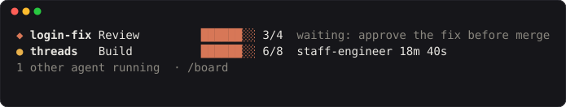
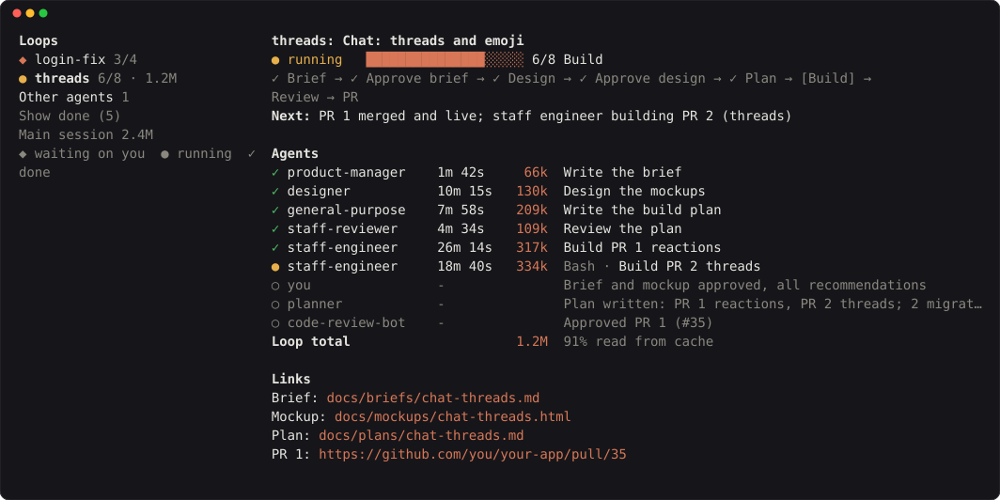

# Agent board

A live board of your work in Claude Code. Each piece of work shows its stage,
what happens next, and the agents working on it. The board sits above the
prompt, and `/board` opens the full view.

Above the prompt, one line per piece of work. What needs you comes first:



`/board` opens the full view. Pick a piece of work on the left to see its
stages, what happens next, every agent that has worked on it (with how long it
took and what it is doing now), notes and links:



- **◆ waiting on you.** Claude needs a decision or an approval.
- **● running.** Claude or its agents are working.
- **✓ done.** The work is finished. `/board` can show or hide finished work.
- **○ a note.** A line from the loop file's `notes`, for people or steps that
  aren't agents, like your approval or a code review bot.

## Install

In a Claude Code terminal session:

```
/plugin install agent-board --marketplace rajgurung/agent-board
```

Answer `y` to add the marketplace, then pick a scope. The user scope makes the
board show up in every project.

## How it works

You don't set anything up. The plugin adds a short section to Claude's
instructions explaining two habits, and the board reads what they produce.

1. **One file per piece of work.** Claude keeps `.claude/loops/<id>.json` up to
   date as the work moves along:

   ```json
   {
     "decision": "threads",
     "title": "Chat: threads and emoji",
     "stages": ["Brief", "Design", "Plan", "Build", "Review", "PR"],
     "stage": 4,
     "next": "Staff reviewer checking the plan",
     "state": "running",
     "notes": { "designer": "Mockup approved" },
     "links": { "Plan": "docs/plans/chat-threads.md" }
   }
   ```

   The stages are whatever fits the work. `state` is `waiting`, `running` or
   `done`.

2. **Agent names start with the work's id.** A subagent described as
   `threads: Review the plan` shows under "threads". Agents without a prefix
   show under "Other agents" in `/board`.

The board checks the files every two seconds, and it watches agents start and
finish as they happen.

You can also write or edit a loop file yourself. The board shows whatever is in
the folder.

You'll probably want to keep these files out of git:

```
.claude/loops/
```

## Develop

```
claude plugin validate .
claude plugin test .
claude --plugin-dir .
```

## Licence

MIT
